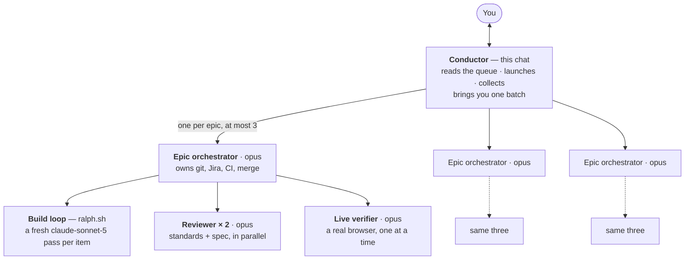
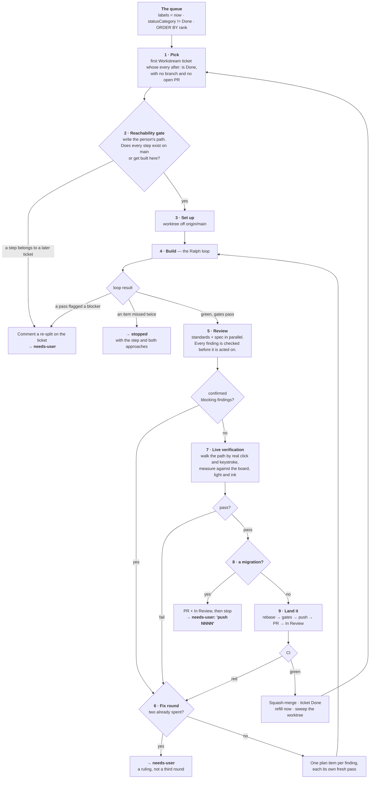
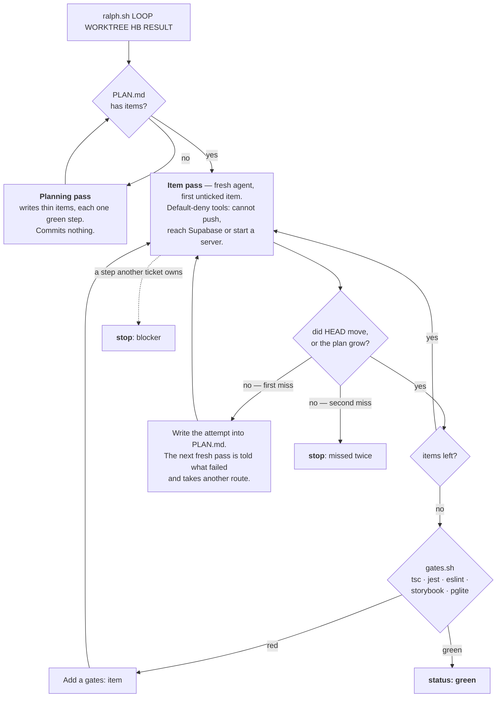

# ship-epics — how a session builds

One session works Pond's Jira epics and ends in merges. The chat is the **conductor**; it never
builds, reviews or verifies anything itself. Everything below it is a subagent or a loop, and only
four kinds of thing come back to you.

The role prompts and scripts in this directory name no tools. Each harness has a head of its own —
`.claude/skills/ship-epics/` and `.cursor/skills/ship-epics/` — whose `harness.md` is the only file
that names one.

## Who runs what

Orchestrators run in parallel because each epic owns its own files and migration numbers. The
browser does not: there is one shared tab, taken through `/tmp/pond-browser.lock`.

## One ticket, nine steps

The two gates that exist because of 9 October 2026, when seven tickets merged and three could not be
used by anyone:

- **Step 2** writes the person's path _before_ any code. An engine-only ticket never passes it alone.
- **Step 7** only clicks. A verifier that evaluates script in the page can make an unreachable
  feature look finished.

## Inside the build loop

`ralph.sh` is a dumb loop around a fresh agent: the same prompt every pass, no memory between
passes, all state in files and git. **Progress is measured from git, so a pass cannot report itself
done.**

**Use a loop when all four hold:** the work is a list of items; each is proven by a command, not by
judgement; the state survives in git and a plan file; and nothing in it needs you, the shared
browser, or a one-way door. Picking, the reachability gate, review, live verification, migrations,
pushes, merges and Jira are therefore **not** loops.

## The clock

No task runs more than ten minutes on one approach. Every agent beats a heartbeat before each task;
its supervisor keeps its own clock alive with `heartbeat.sh relay`, which reads the child's current
step in the same breath it writes its own — so a supervisor's clock moves when its child's work
does, and cannot go stale.

A step's clock runs from the first of a run of _identical_ beats. That is deliberate: an agent stuck
in a retry loop still reads as stalled even while it keeps beating.

## What reaches you

Only four things, batched once every orchestrator has returned:

|                |                                                                                                  |
| -------------- | ------------------------------------------------------------------------------------------------ |
| **merged**     | what landed, and what a person can now _do_ — the path, not the ticket title                     |
| **needs-user** | a production migration, a failed reachability gate with a proposed re-split, or a genuine ruling |
| **stopped**    | a stall, or a failure after two fix rounds                                                       |
| **blocked**    | nothing in the epic is ready, and what each candidate waits on                                   |

Everything else — picking, planning, building, reviewing, fixing, verifying, rebasing, merging and
sweeping — happens without you.
